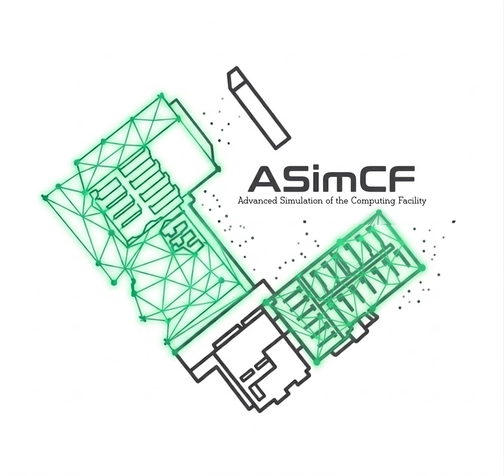

# ASimCF
Digital Twin Tools for Data Centres

Currently this is a place holder, but when we release the first version ASimCF it will be hosted here.

ASimCF is based on the [ExaDigiT](https://exadigit.github.io/) framework.
